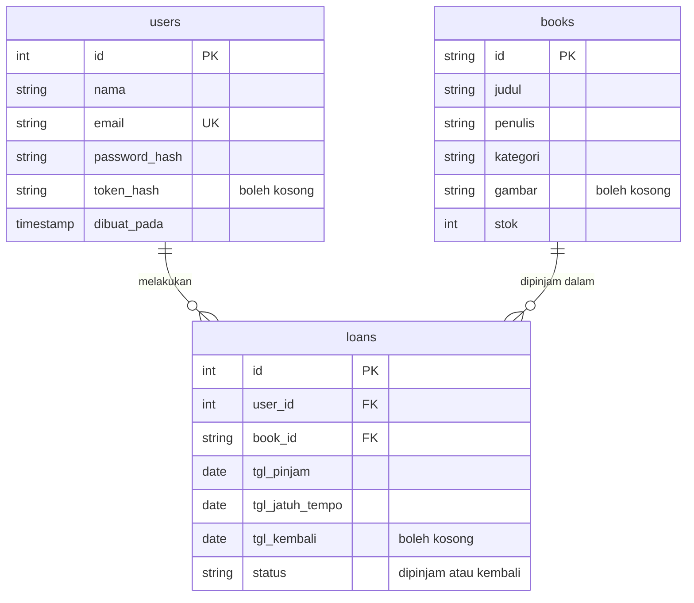

# ERD PustakaKita



## Relasi

- Satu user dapat memiliki banyak peminjaman (1 ke N).
- Satu buku dapat tercatat di banyak peminjaman (1 ke N).

## Catatan Kolom Tabel `users`

| Kolom | Keterangan |
|---|---|
| `password_hash` | Hasil `password_hash()` PHP (bcrypt, berawalan `$2y$`). Password asli tidak pernah disimpan. |
| `token_hash` | Hash SHA-256 dari token sesi. Diisi saat login dan dikosongkan (`NULL`) saat logout. Token asli hanya dikirim ke aplikasi. |
| `dibuat_pada` | Waktu akun dibuat, terisi otomatis oleh MySQL. |

## Aturan Denda Keterlambatan

Denda dihitung per hari keterlambatan dari tabel `loans`. Nilai denda **tidak disimpan sebagai kolom**, tetapi dihitung dari kolom yang sudah ada, sehingga struktur ERD tidak berubah.

```
hari_terlambat = max(0, tgl_kembali - tgl_jatuh_tempo)      (dalam hari)
denda          = hari_terlambat x tarif_per_hari
```

Jika buku belum dikembalikan (`tgl_kembali` kosong), `tgl_kembali` diganti dengan tanggal hari ini.

| Parameter | Nilai | Keterangan |
|---|---|---|
| `tarif_per_hari` | **Rp 1.000** (usulan, menunggu konfirmasi tim) | Disimpan sebagai satu konstanta di aplikasi |
| Durasi pinjam | 7 hari (usulan) | `tgl_jatuh_tempo = tgl_pinjam + durasi pinjam` |
| Dikembalikan tepat waktu | denda = 0 | |

Contoh: jatuh tempo 10 Des, dikembalikan 14 Des, maka terlambat 4 hari dan denda = 4 x 1.000 = **Rp 4.000**.

## Penyimpanan Data: Tabel Mana di Mana

| Data | Penyimpanan | Alasan |
|---|---|---|
| `users` | **MySQL** (server) | Data akun harus aman dan dipakai bersama; password disimpan dalam bentuk hash (`password_hash`) |
| `books` | **MySQL** (server) | Sumber data utama katalog, termasuk `stok` |
| `loans` | **MySQL** (server) | Data transaksi peminjaman harus konsisten antar perangkat |
| Salinan `books` dan `loans` | **SQLite** (lokal) | Cache supaya katalog dan riwayat tetap bisa dibuka saat offline |
| Sesi login (token di perangkat) | **Hive** (lokal) | Key-value sederhana dan cepat; server hanya menyimpan hash token di `users.token_hash` |
| Buku favorit | **Hive** (lokal) | Data kecil per perangkat |
| Preferensi (filter kategori terakhir, dll.) | **Hive** (lokal) | Pengaturan ringan |

Alur: aplikasi mengambil data lewat API ke MySQL, menyimpan salinan ke SQLite untuk akses offline, dan memakai Hive untuk sesi serta preferensi.